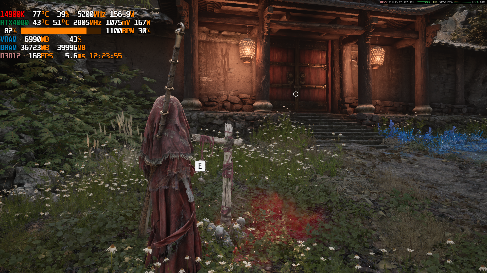

# 影之刃零 · 新娘阿花替换 Mod

把《影之刃零 / Phantom Blade Zero》主角「魂」的外观替换为 Boss「新娘阿花」。
保留原主角的操作、动画、碰撞、相机与武器系统，不改游戏 pak，不写存档。

[**⬇ 下载最新版**](https://github.com/liweinan0423/PBZ-AHua-Replace/releases/latest) ·
[安装](#安装) ·
[卸载](#卸载) ·
[常见问题](#常见问题) ·
[从源码构建](#从源码构建)



---

## 功能

- 主角外观替换为 **新娘阿花（AHua_Body）**
- 同时挂载 3 件 Chaos 布料：`CA_AHua_Cloth01/02/03`
- 按骨名共享主角实时姿势，**保留原主角全部动画**
- 保留原主角碰撞胶囊、相机高度、16 条原生武器挂点
- **自动应用**：进入场景后约 1–3 秒生效，无需按任何键
- 只放一个 `version.dll` 代理；不修改游戏 pak、不写存档
- 安装时自动备份原有 `version.dll`，可随时恢复

---

## 支持的游戏版本

| 项目 | 值 |
|---|---|
| 游戏 | Phantom Blade Zero / 影之刃零 |
| Steam build | **26367565**（2026-11-04 更新） |
| PBZ.exe SHA-256 | `4415933ce33476f14c837abb61a1b60af8b78cd81783896501913a7aac69e423` |

> 本 Mod 按 `PBZ.exe` 的 SHA-256 锁定版本。游戏更新后 DLL 会写入
> `UNSUPPORTED_BUILD` 并停止工作（不会修改游戏内存），需要等待新版本。

---

## 下载

**推荐：从 Releases 下载**

- 最新版页面：<https://github.com/liweinan0423/PBZ-AHua-Replace/releases/latest>
- 直接下载最新版：
  <https://github.com/liweinan0423/PBZ-AHua-Replace/releases/latest/download/AHuaReplace.zip>

### Nexus Mods 上传材料

Nexus 页面尚未发布（Nexus 没有公开上传 API，需要在网页端用作者账号上传）。
上传字段、BBCode 描述和权限说明见 [`NEXUS.md`](NEXUS.md)。

Nexus 专用精简包（0.98 MB，适合网页上传）：
[`nexus/AHuaReplace_1.0.1.zip`](nexus/AHuaReplace_1.0.1.zip)

也可以直接克隆本仓库，`version.dll` 就在仓库根目录：

```bash
git clone https://github.com/liweinan0423/PBZ-AHua-Replace.git
```

压缩包内容：

```
AHuaReplace/
  Install.bat      双击安装
  Uninstall.bat    双击卸载
  version.dll      独立替换组件（3.63 MB）
  install.ps1      安装脚本（由 Install.bat 调用）
  uninstall.ps1    卸载脚本（由 Uninstall.bat 调用）
  README.txt       简要说明
  preview.png      预览图
```

---

## 安装

### 一键安装（PowerShell）

```powershell
powershell -ExecutionPolicy Bypass -Command "irm https://raw.githubusercontent.com/liweinan0423/PBZ-AHua-Replace/main/install-from-github.ps1 | iex"
```

它会下载最新 Release、解压并调用安装脚本。如果不希望远程执行脚本，
请使用下面的手动步骤。

### 手动步骤（普通玩家推荐）

1. **完全退出游戏**（包括后台进程 / 托盘）。
2. 下载 `AHuaReplace.zip`。
3. 把整个 **AHuaReplace 文件夹** 解压到游戏根目录，例如：

   ```
   C:\Program Files (x86)\Steam\steamapps\common\PBZ\
   ```

   解压后应同时看到：

   ```
   ...\PBZ\AHuaReplace\
   ...\PBZ\platform\
   ```

4. 双击：

   ```
   AHuaReplace\Install.bat
   ```

5. 启动游戏，**加载任意存档**；进入场景后约 **1–3 秒**自动应用「新娘阿花」。

> **为什么不是双击 install.ps1？**
> Windows 默认双击 `.ps1` 会用记事本打开，而不是执行脚本。
> 所以请双击 `Install.bat`，它等价于运行 `install.ps1`，并会自动向上查找
> 游戏根目录（`platform\steam\PBZ.exe` 所在的那一层）。

如果游戏不在默认位置，也可以直接指定：

```powershell
powershell -ExecutionPolicy Bypass -File install.ps1 -GameDir "D:\Steam\steamapps\common\PBZ"
```

### 验证是否成功

查看日志：

```
<游戏目录>\platform\steam\AHuaReplace.log
```

成功时应看到：

```
KNOWN_BUILD sha256 verified
GAME_THREAD_HOOK installed; AHua auto-apply armed
NPC_RETARGET applied id=AHua ... display=AHua_Body
AHUA_ACTIVE
```

游戏内表现为：主角变成红衣「新娘阿花」，布料跟随动作摆动。

---

## 卸载

1. **完全退出游戏**。
2. 运行：

   ```powershell
   powershell -ExecutionPolicy Bypass -File uninstall.ps1
   ```

3. 脚本会删除 `version.dll`，并恢复安装前备份的 `version.dll`
   （`version.dll.backup_<时间戳>`）。

也可以手动删除：

```
<游戏目录>\platform\steam\version.dll
```

游戏本体 pak 与存档不会被修改。

---

## 常见问题

### 1. 日志出现 `UNSUPPORTED_BUILD`

游戏更新后 `PBZ.exe` 变了，当前 DLL 拒绝工作。请：

1. 运行 `uninstall.ps1` 恢复原文件；
2. 等待本仓库发布适配新版本的构建；
3. 或按 [从源码构建](#从源码构建) 自行编译。

### 2. 安装后没有变化

- 确认已经**加载存档并进入可操控场景**（主菜单不会应用）。
- 查看 `AHuaReplace.log` 是否有 `AHUA_ACTIVE`。
- 确认游戏目录下没有另一个 `version.dll` 覆盖本 Mod。
- 确认杀毒软件没有隔离 `version.dll`。

### 3. 游戏无法启动 / 启动崩溃

1. 删除 `<游戏目录>\platform\steam\version.dll`；
2. 或恢复 `version.dll.backup_<时间戳>`；
3. 确认游戏版本与上表一致。

### 4. 之前装过其他 `version.dll` Mod

安装脚本会把原有文件备份为 `version.dll.backup_<时间戳>`。多个
`version.dll` 代理不能同时生效；请只保留一个。

### 5. 会影响联机 / 存档吗？

本 Mod 只替换本地外观，不写入存档，不修改 pak。建议只在单机模式使用；
任何第三方 Mod 都不应在联机场景使用。

---

## 原理

- AHua 的 **161 根骨骼**是主角实际身体 `Hun_Body_Simple`（264 骨）的
  子集，**骨名与父子关系 100% 一致**。
- DLL 在游戏线程上把 AHua 网格与 3 个 Chaos 布料挂到主角的显示组件，
  并按骨名共享主角的实时骨骼姿势。
- 相机高度、碰撞胶囊、武器挂点由重定向系统自动处理。
- 只替换显示层，不改玩家操作、判定、动画蓝图或存档。

详细技术说明见 [`source/README.md`](source/README.md) 与 [`NOTICE.md`](NOTICE.md)。

---

## 从源码构建

需要：

- Windows 10/11 x64
- Visual Studio 2022（含 C++ 桌面开发 + MASM）
- CMake 3.24+

```powershell
cd source
powershell -ExecutionPolicy Bypass -File build.ps1
```

`build.ps1` 会拉取上游 `cringe-blade-zero` 的固定提交，并把裁剪目标编译为
`source/build/bin/version.dll`。

详细说明见 [`source/README.md`](source/README.md)。

---

## 已知限制

- 按 `PBZ.exe` 版本锁定，游戏更新后需重新构建。
- AHua 与 Hun 的手部绑定姿态约有 **38–56°** 差异，极端姿势下腕部可能轻微变形。
- 攻击、技能、过场、传送后的表现建议继续实测。
- 依赖 `version.dll` 代理；与其他代理类 Mod 不能同时使用。

---

## 来源与致谢

- 重定向子系统来自开源项目
  [**Jersyi/cringe-blade-zero**](https://github.com/Jersyi/cringe-blade-zero)。
  本仓库只做 AHua 档案的裁剪、自动应用与打包。
- 上游仓库当前**未声明许可证**；本仓库不主张对 `version.dll` 的额外授权，
  二进制按“原样”提供，仅供个人使用。详见 [`NOTICE.md`](NOTICE.md)。
- 《影之刃零 / Phantom Blade Zero》及角色版权归 S-GAME / 官方所有。
  本 Mod 为非官方粉丝作品，与官方无关。

## 免责声明

本 Mod 按“现状”提供，不附带任何明示或暗示担保。使用前请备份
`version.dll`；因使用本 Mod 导致的游戏异常、存档问题或其他损失，由使用者自行承担。
